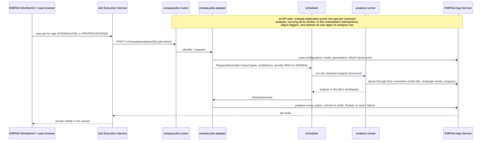

# EMPAIA integration

EMPAIA is a provider: it decides where an analysis's inputs come from and
where its outputs go. An analysis becomes one EMPAIA app through its
`expose.empaia` section; served models, the analysis runner and the scheduler
are the same ones the standalone API uses.

## One job

## Code

| Module | Role |
| --- | --- |
| `catalog/analyses/exposure/` | `expose.empaia`: its keys (`fields.py`), its schema (`schema.py`), and picking converters and publishers with the load-time checks in `resolution.py`: EMPAIA's name limit, preprocessing without required inputs, parameters, bound shapes |
| `components/empaia/` | Converters (`wsi`, `rectangle`, `primitive`) and publishers (`primitive`, `continuous_pixelmap`), one per EAD type |
| `providers/empaia/provider.py` | The provider: what EMPAIA adds to the API and to replicas |
| `providers/empaia/ead/` | `apps.py` merges the components' fragments into each app's EAD v3; `vocabulary.py` holds modes, triggers and viewer settings |
| `providers/empaia/registration.py`, `triggers.py` | At startup, retried: register the apps, align the preprocessing triggers, delete owned apps no analysis has (namespace `org.empaia.rationai.…` and image on this JES target) |
| `providers/empaia/jobs/` | The JES-facing routes, payload parsing, the scheduler adapter (`adapter.py`, which also runs the publication loop), input access |
| `providers/empaia/app_service/` | The App Service gateway, one method per SDK call family, over the `rationai.empaia` SDK client |

## Modes and data types

- **STANDALONE:** the user draws a region of interest and fills in the
  parameters; the job gets every input and runs at high priority.
- **PREPROCESSING:** the job gets the required inputs (the slide) only and
  runs at normal priority.
- **Types:** inputs `wsi`, `rectangle` and primitive parameters; outputs
  primitives (from the `value` format) and one-channel continuous pixelmaps
  (from `score_grid`). A new EMPAIA type is a new converter or publisher in
  `components/empaia/` once the SDK can carry it.

## SDK use

The App Service calls (configuration, mode, inputs, outputs, finalize, failure,
pixelmap upload) go through `rationai.empaia.Client`. The SDK is built from a
branch on top of its merge request !10 and shipped as a wheel in
`deploy/images/wheels/` until that is released. Marketplace registration in
`registration.py` uses its own `httpx` calls rather than the SDK.

## Evidence

Dated live runs are in [docs/operations/](../operations/), from the first
mocked JES job (2026-10-21) to self-registration with both modes on the test
instance (2026-11-01).
