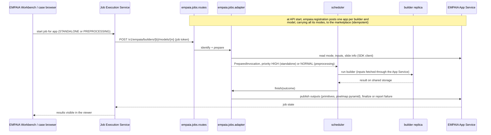

# EMPAIA integration

EMPAIA is a provider: it decides where a builder's inputs come from and where its
outputs go. Builders, models and the scheduler are the same ones the standalone
API uses; nothing in them names EMPAIA.

## One job

## Code

| Module | Role |
| --- | --- |
| `providers/empaia/provider.py` | The provider: what EMPAIA adds to the API and to builder replicas |
| `providers/empaia/registration.py` | Marketplace registration at startup, retried; logs an error after 3 failures in a row |
| `providers/empaia/ead/` | Generates the EMPAIA App Description (EAD v3) per builder and model; `builder_io.py` maps builder inputs and outputs to EMPAIA types |
| `providers/empaia/jobs/` | The JES-facing route, payload parsing, the scheduler adapter (`adapter.py`), input resolution |
| `providers/empaia/app_service/` | The App Service gateway over the `rationai.empaia` SDK client |
| `providers/empaia/publishing/` | Two-phase publication: prepare every output, then commit; pixelmaps are built as pyramids with the SDK's `ScalarImageOutput` |

## Modes and data types

- **STANDALONE:** the user draws a region of interest; the job gets every
  builder input, including the region, and runs at high priority.
- **PREPROCESSING:** the job gets the slide only and runs at normal priority.
- **Published types:** primitives and continuous pixelmaps today. A new type is
  a publisher in `publishing/publishers.py` plus its mapping in
  `ead/builder_io.py`; `tests/` fails if a builder output has neither a mapping
  nor an entry in `NOT_OFFERED`.

## SDK use

The App Service calls (configuration, mode, inputs, outputs, finalize, failure,
pixelmap upload) go through `rationai.empaia.Client`. The SDK is built from a
branch on top of its merge request !10 and shipped as a wheel in
`deploy/images/wheels/` until that is released. Marketplace registration in
`registration.py` uses its own `httpx` calls rather than the SDK.

## Evidence

Dated live runs are in [docs/operations/](../operations/), from the first
mocked JES job (2026-10-21) to self-registration with both modes on the test
instance (2026-11-01).
