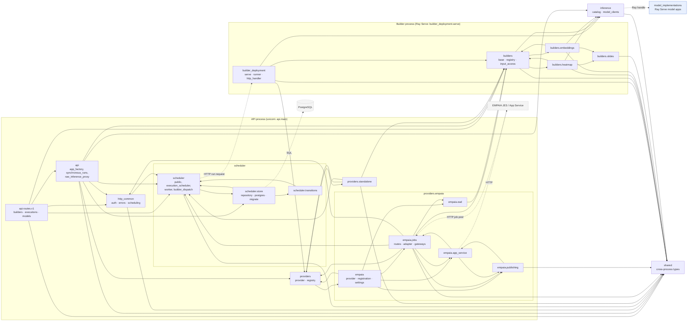
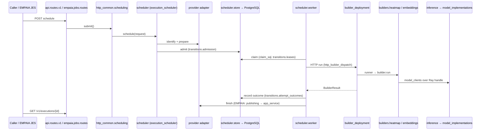

# Module graph

Generated from the runtime imports in `src/model_service` (imports under
`TYPE_CHECKING` are left out). Solid arrows mean "imports"; dashed arrows are
calls across a process or network boundary that no import shows.

## Packages and processes

`store ⇄ scheduler`, `app_service ⇄ jobs` and the loop
`scheduler → store → transitions → scheduler` exist at package level only. The
modules on each side import different files, so no import cycle runs at
runtime.

## One scheduled job

