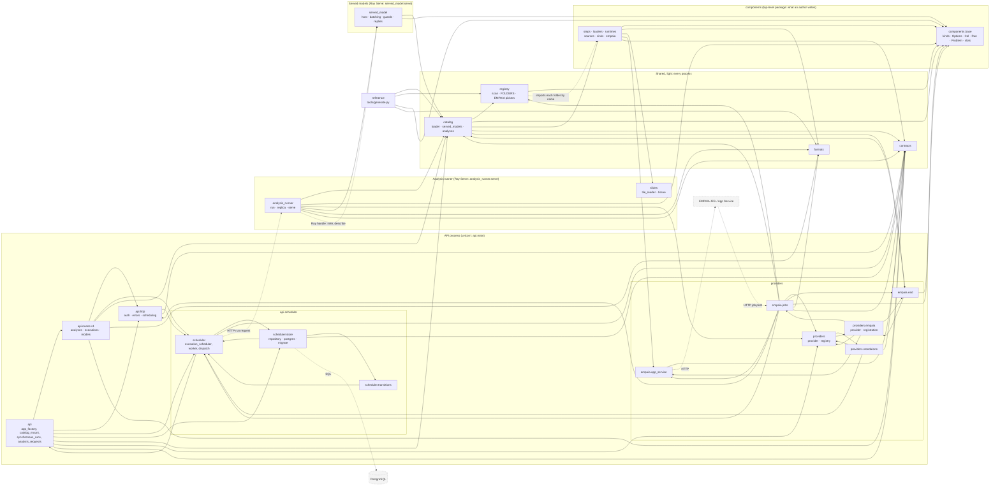
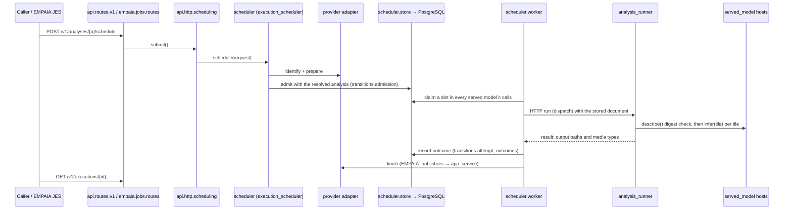

# Module graph

Drawn from the runtime imports in `src/model_service` and `src/components` on
2026-11-23 (imports under `TYPE_CHECKING` are left out). Solid arrows mean "imports"; dashed
arrows are calls across a process or network boundary that no import shows.
`tests/test_process_boundaries.py` checks the part that matters most: the API
process loads no Ray, ONNX Runtime, torch, OpenSlide or replica code, and
the shared packages stay light.

## Packages and processes

A few arrows cross into packages of another process at module level only:

- `catalog` imports `providers.empaia.ead` for the EMPAIA vocabulary (modes,
  triggers, viewer settings) that `expose.empaia` is checked against;
- the EMPAIA converters and publishers in `components.empaia` import the
  gateway errors and types of `providers.empaia.app_service`, and
  `slide_tiles` imports `slides` inside its methods only, so the API never
  loads OpenSlide;
- `analysis_runner` imports `served_model.guards` to check each model's
  output against its declaration.

Between the two top-level packages, `components.base` imports nothing from
`model_service` at run time (`tests/test_process_boundaries.py` checks it).
The component folders import `model_service.formats`, `contracts` and the
EMPAIA gateway; none of those import `components`, and the registry finds
the folders by name, so no import cycle crosses the two packages.

`scheduler ⇄ store`, `empaia ⇄ ead` and `scheduler → api` exist at package
level only; the modules on each side import different files, so no import
cycle runs.

## One scheduled run

