# Durable workflow execution, visually explained

Historical walkthrough. Its diagrams and deployment examples predate current
context separation and the native full-WSI profile. Use
[the documentation map](../README.md) and current package guides for actual
contracts. Public workflow/execution routes use `/v1`; protected execution context
is separate from the persisted invocation. This is not a deployment runbook.

This document traces the workflow execution changes across `model-service` and
`rationai-sdk-python`. It covers the public API, synchronous and scheduled
execution, PostgreSQL recovery, provider adapters, the prostate heatmap, the
SDK, deployment, and test coverage.

## What changed

The model service grew from direct calls to individual Ray Serve models into a
workflow system with synchronous and durable execution modes.

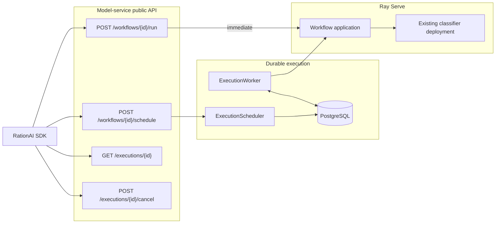

The implementation spans two repositories.

```text
model-service/
├── workflow_execution/                  workflow contract and runtime
│   ├── README.md                        package ownership map
│   ├── contracts.py                     typed domain values only
│   ├── serialization.py                 JSON transport codecs
│   ├── catalog.py                       declarative workflow registry
│   ├── application.py                   validation and execution boundary
│   ├── shared_storage.py                standalone filesystem access
│   ├── http.py                          shared workflow error envelope
│   ├── prostate_heatmap.py              heatmap workflow
│   └── prostate_heatmap_serve.py        Ray Serve deployment
│
├── execution_scheduler/                 durable orchestration
│   ├── README.md                        package ownership map
│   ├── api.py                           public HTTP API
│   ├── scheduler.py                     admission, reads, and cancellation
│   ├── worker.py                        claims, renewal, dispatch, settlement
│   ├── active_work.py                   local task cancellation registry
│   ├── transitions.py                   state-transition policy
│   ├── repository.py                    persistence interface and test adapter
│   ├── postgres.py                      PostgreSQL persistence operations
│   ├── postgres_schema.py               PostgreSQL schema creation
│   ├── dispatch.py                      Ray Serve HTTP boundary
│   ├── providers.py                     provider interface and outcomes
│   ├── standalone.py                    ordinary SDK requests
│   ├── security.py                      protected-context encryption
│   ├── runtime.py                       production composition root
│   └── settings.py                      typed operational settings
│
├── integrations/empaia/                 EMPAIA-specific adapters
│   ├── gateway.py                       external gateway protocol and loader
│   ├── provider.py                      scheduling and provider finish
│   └── input_access.py                  workflow input materialization
│
├── workflow-definitions/
│   └── prostate-heatmap.yaml            workflow declaration
├── helm/rayservice/                     Ray and scheduler deployment
└── tests/                               contract through integration coverage

rationai-sdk-python/
├── rationai/resources/workflows.py      run and schedule
├── rationai/resources/executions.py     poll and cancel
├── rationai/types/workflows.py          public typed models
└── rationai/errors.py                   typed API failures
```

## Boundaries after the cleanup

The cleanup did not redesign the execution protocol. It split modules by the
decision each one owns. Core packages now avoid importing provider-specific or
database-library details.

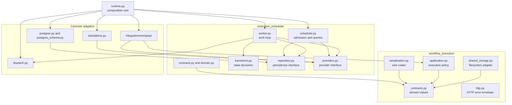

| Before | After | Reason |
| --- | --- | --- |
| Domain values and JSON parsing shared `contracts.py` | JSON parsing moved to `serialization.py` | Domain types no longer own transport parsing |
| Shared-storage path logic lived in `application.py` | Path logic moved to `shared_storage.py` | The workflow runner depends on an access interface |
| Admission and background execution shared `scheduler.py` | Work execution moved to `worker.py`; local task tracking moved to `active_work.py` | HTTP-facing scheduling and lease-driven work have separate lifecycles |
| Schema creation lived in `postgres.py` | Schema creation moved to `postgres_schema.py` | Runtime persistence operations no longer contain DDL |
| EMPAIA code lived inside both core packages | EMPAIA moved to `integrations/empaia/` | Core workflow and scheduler packages remain provider-neutral |
| Ray workflow HTTP errors lived in the prostate application | Shared error types moved to `workflow_execution/http.py` | Other workflow applications can use the same envelope |
| The catalog parsed `.yaml` files as JSON | The catalog uses safe YAML loading and typed kind parsers | The file format and parser now agree while input and output kinds stay closed |

Three behavior fixes came with the split:

- The workflow timeout handler now distinguishes its own expired deadline from
  cancellation raised by an outer caller.
- Input-access setup and cleanup now sit inside the safe workflow error
  boundary, so adapter failures cannot leak raw exceptions.
- PostgreSQL translates `psycopg` failures to
  `ExecutionRepositoryUnavailableError`; the scheduler no longer imports or
  catches database-driver exceptions.

Package guides: [`workflow_execution/README.md`](../../workflow_execution/README.md)
and [`execution_scheduler/README.md`](../../execution_scheduler/README.md).

## The common workflow contract

Synchronous and scheduled execution use the same domain objects.

```text
WorkflowInvocation
├── inputs: dict[str, WorkflowInput]
│   ├── InlineInput
│   │   ├── kind = "inline"
│   │   └── value: JSON
│   ├── SharedPathInput
│   │   ├── kind = "shared_path"
│   │   └── path: str
│   └── ProviderInput
│       ├── kind = "provider"
│       └── name: str
├── resolved_configuration: dict[str, JSON]
├── input_access: InputAccessContext
│   ├── kind: adapter registry key
│   └── state: adapter-specific JSON
└── deadline_at: timezone-aware datetime

WorkflowResult
└── outputs: dict[str, WorkflowOutput]
    ├── InlineOutput
    │   ├── kind = "inline"
    │   └── value: JSON
    └── SharedArtifact
        ├── kind = "shared_artifact"
        ├── path: str
        └── media_type: str | None
```

The tagged variants are frozen dataclasses. Their explicit tags stop an inline
string such as `"some/file.tiff"` from being mistaken for an artifact path.

The workflow definition independently declares which names and variants it
accepts.

```json
{
  "identifier": "prostate-heatmap",
  "inputs": {
    "slide": {"kinds": ["shared_path", "provider"]},
    "region_of_interest": {"kinds": ["shared_path", "provider"]}
  },
  "outputs": {
    "heatmap": {"kind": "shared_artifact", "media_type": "image/tiff"}
  }
}
```

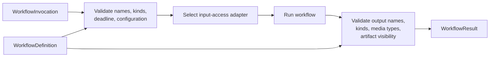

The boundary rejects:

- missing or extra inputs;
- incorrect input variants;
- expired or timezone-naive deadlines;
- malformed workflow-specific configuration;
- output sets that differ from the definition;
- artifacts outside the visible storage boundary;
- incomplete or missing output files.

Code: [`workflow_execution/contracts.py`](../../workflow_execution/contracts.py),
[`workflow_execution/serialization.py`](../../workflow_execution/serialization.py),
[`workflow_execution/catalog.py`](../../workflow_execution/catalog.py),
[`workflow_execution/application.py`](../../workflow_execution/application.py),
and [`workflow_execution/shared_storage.py`](../../workflow_execution/shared_storage.py).

## Synchronous execution

The public endpoint is `POST /v1/workflows/{workflow_id}/run`.

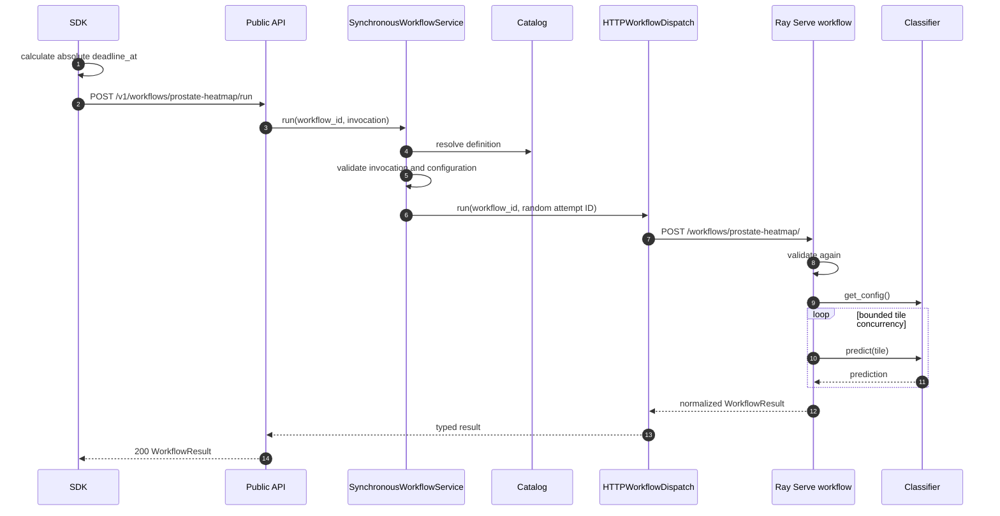

This path creates no durable execution record. The caller owns its lifetime.

```text
run request
  start Ray dispatch task
  start client-disconnect watcher

  wait for first completion
    dispatch completes
      cancel disconnect watcher
      return result

    client disconnects
      cancel dispatch task
      propagate cancellation toward Ray Serve
```

Failure mapping:

| Ray response or event | Public response |
| --- | --- |
| Successful typed result | `200` |
| Unknown workflow | `404 unknown_workflow` |
| Invalid invocation or configuration | `422 invalid_workflow_invocation` |
| Explicit Ray queue rejection | `429 workflow_backpressure` |
| Classified permanent workflow error | `422` with workflow error code |
| Classified retryable workflow error | `503` with workflow error code |
| Transport failure or ambiguous outcome | `503 workflow_dispatch_unavailable` |

A Ray `429` proves that Ray rejected the request before execution. A generic
`503` or a lost HTTP connection cannot prove whether Ray started the workflow,
so the dispatcher treats it as an unknown outcome.

Code: [`execution_scheduler/synchronous.py`](../../execution_scheduler/synchronous.py),
[`execution_scheduler/api.py`](../../execution_scheduler/api.py), and
[`execution_scheduler/dispatch.py`](../../execution_scheduler/dispatch.py).

## Scheduled execution

Scheduled work adds an execution record and separates admission from
processing.

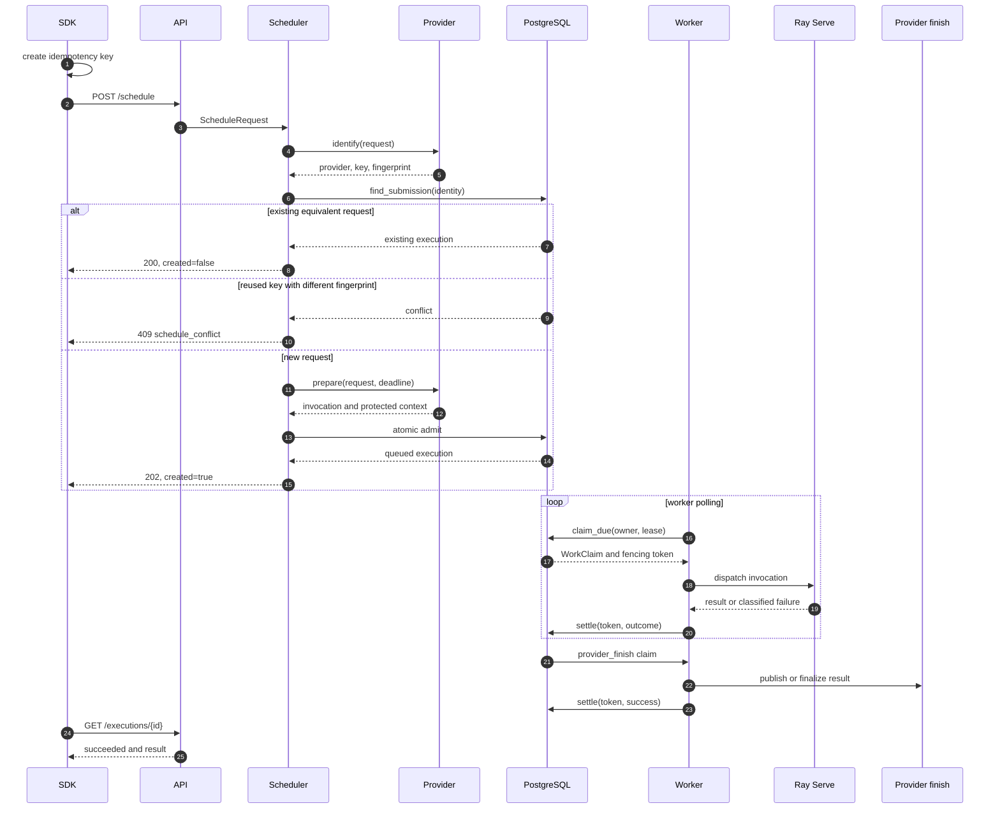

Admission has two idempotency checks.

```text
SubmissionIdentity
├── provider name
├── submission key
└── request fingerprint

same provider + same key + same fingerprint
  return the existing execution

same provider + same key + different fingerprint
  reject with 409

new provider + key
  atomically insert one execution
```

PostgreSQL enforces uniqueness on `(provider, submission_key)`. Concurrent
equivalent requests still create one execution.

## Execution state and work state

Public status and internal work are separate concepts.

| Public status | Internal work kind |
| --- | --- |
| `QUEUED` | `PROCESSING` |
| `RUNNING` | `PROCESSING` |
| `RUNNING` | `PROVIDER_FINISH` |
| `FAILED` | `PROVIDER_FAILURE_REPORT` or none |
| `CANCELLED` | `PROVIDER_CANCELLATION_REPORT` or none |
| `SUCCEEDED` | none |

The split lets an execution become terminal locally before a best-effort
external report finishes.

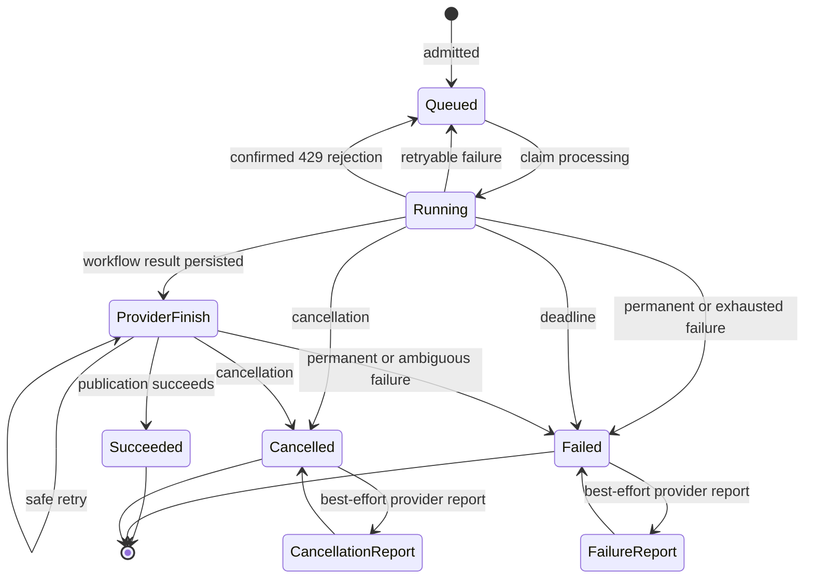

### Confirmed backpressure

An explicit `429` does not consume a processing attempt.

```text
processing claim increments processing_attempts

if Ray returns explicit 429
  decrement processing_attempts
  increment processing_rejections
  wait max(exponential_backoff, Retry-After)
  return to QUEUED
```

Ray demonstrably did not start the workflow.

### Unknown dispatch outcomes

A transport failure does consume an attempt.

```text
request sent
connection disappears
Ray acceptance is unknown

therefore
  count the attempt
  retry only while policy allows
  never claim exactly-once processing
```

[`execution_scheduler/transitions.py`](../../execution_scheduler/transitions.py)
owns the transition policy. The in-memory and PostgreSQL repositories use the
same policy.

## Leases, recovery, and fencing

Every claimed work item receives a new fencing token.

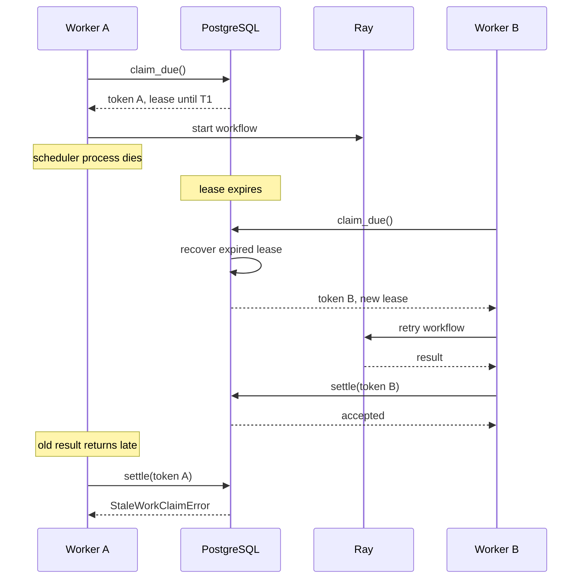

The guarantee is explicit.

```text
Durable record             yes
Abandoned-work recovery    yes
Stale worker mutation      rejected
Exactly-once execution     no
At-least-once execution    yes
```

The worker renews the lease every one-third of its duration. Renewal returns a
typed directive.

```text
RenewDirective
├── CONTINUE
├── CANCEL
├── DEADLINE_EXCEEDED
└── LEASE_LOST
```

PostgreSQL claims work as follows.

```text
claim_due
├── use database clock
├── expire deadlines
├── recover expired leases
├── prioritize provider-finish work
├── group processing candidates by workflow
├── acquire a transaction advisory lock for the workflow
├── enforce the per-workflow active limit
├── select row FOR UPDATE SKIP LOCKED
└── install owner, token, and expiry atomically
```

Code: [`execution_scheduler/worker.py`](../../execution_scheduler/worker.py),
[`execution_scheduler/postgres.py`](../../execution_scheduler/postgres.py), and
[`execution_scheduler/postgres_schema.py`](../../execution_scheduler/postgres_schema.py).

## Cancellation and deadlines

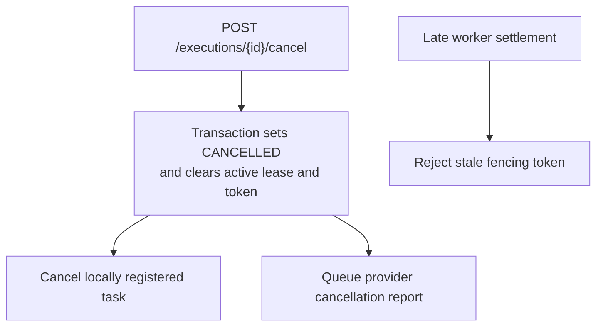

PostgreSQL cancellation is authoritative. Cancelling a local task saves work,
but fencing prevents late results from undoing cancellation.

Deadline checks exist at several boundaries.

```text
SDK run()
  creates an absolute workflow deadline

scheduler admission
  caps the caller timeout at the configured maximum
  caps EMPAIA work at credential expiry

workflow application
  uses asyncio.timeout with the remaining absolute time

lease renewal
  fails work when database time reaches the deadline

settlement
  refuses results that arrive after the deadline

poll and claim pass
  expires abandoned overdue records
```

## Provider adapters

The scheduler selects a provider adapter rather than embedding provider logic.

```text
ProviderAdapter
├── identify(request) -> SubmissionIdentity
├── prepare(request, deadline) -> PreparedWorkflow
└── finish(protected_context, outcome) -> None

Implementations
├── StandaloneProviderAdapter
└── EmpaiaProviderAdapter
```

### Standalone execution

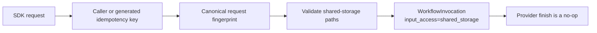

### EMPAIA execution

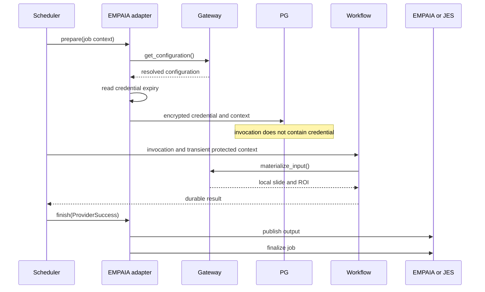

The scheduler never refreshes the original credential. Its `exp` claim limits
the execution deadline.

Publication retries follow a conservative rule.

```text
publish or finalize fails
  if the failure is retryable
     and no externally visible mutation may have happened
       retry from the durable result without rerunning inference
  else
       do not retry publication
       fail safely
```

This rule avoids a duplicate upload or finalization when the remote outcome is
ambiguous.

The concrete EMPAIA HTTP implementation remains an injected gateway factory.

```text
EMPAIA_GATEWAY_FACTORY = "module:attribute"
```

The scheduler and Ray worker images must both contain that module.

Code: [`execution_scheduler/providers.py`](../../execution_scheduler/providers.py),
[`execution_scheduler/standalone.py`](../../execution_scheduler/standalone.py),
[`integrations/empaia/gateway.py`](../../integrations/empaia/gateway.py),
[`integrations/empaia/provider.py`](../../integrations/empaia/provider.py), and
[`integrations/empaia/input_access.py`](../../integrations/empaia/input_access.py).

## Protected provider context

Credentials do not become part of the ordinary invocation.

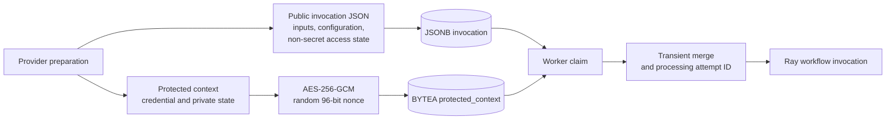

The encrypted envelope contains a version byte, a random nonce, authenticated
ciphertext, and fixed associated data.

Protected context is absent from:

- submission fingerprints;
- public execution responses;
- stored invocation JSON;
- ordinary log messages.

Code: [`execution_scheduler/security.py`](../../execution_scheduler/security.py).

## Prostate heatmap workflow

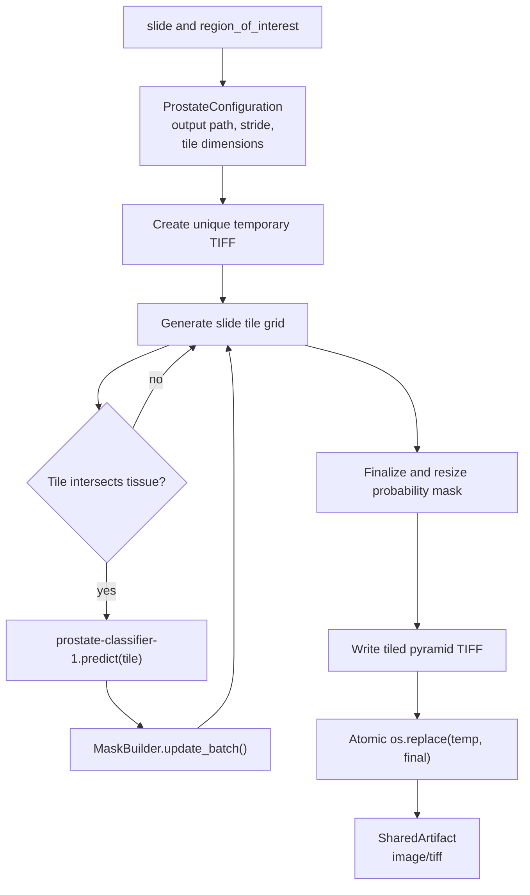

Tile concurrency is bounded.

```text
for each tile
  if active tasks reached max_concurrent_tasks
    wait until at least one finishes
    surface any task failure

  schedule a task
    read slide and tissue tile in the thread pool
    skip non-tissue
    await batched classifier prediction
    add prediction to the mask builder
```

The workflow writes to a temporary file. It atomically renames that file only
after processing succeeds. Failure cleanup removes the temporary artifact, so
consumers never see a partial heatmap as a completed result.

The existing classifier gained a typed configuration endpoint.

```diff
 BinaryClassifier
+  tile_size
+  output_tile_size
+  n_channels
+  mpp
+
+  get_config() -> dict[str, float | int]
   predict(images)
```

The classifier deployment owns its model geometry. The workflow reads it from
the deployment instead of copying the values into another configuration.

Code: [`workflow_execution/prostate_heatmap.py`](../../workflow_execution/prostate_heatmap.py),
[`workflow_execution/prostate_heatmap_serve.py`](../../workflow_execution/prostate_heatmap_serve.py),
and [`models/binary_classifier.py`](../../models/binary_classifier.py).

## Strong typing and intentional strings

Closed domain values use enums.

```text
StrEnum
├── ExecutionStatus
│   ├── QUEUED
│   ├── RUNNING
│   ├── SUCCEEDED
│   ├── FAILED
│   └── CANCELLED
├── WorkKind
│   ├── PROCESSING
│   ├── PROVIDER_FINISH
│   ├── PROVIDER_FAILURE_REPORT
│   └── PROVIDER_CANCELLATION_REPORT
├── RenewDirective
│   ├── CONTINUE
│   ├── CANCEL
│   ├── DEADLINE_EXCEEDED
│   └── LEASE_LOST
├── ApiErrorCode
├── ExecutionErrorCode
├── WorkflowFailureCode
├── WorkflowHTTPErrorCode
└── EmpaiaErrorCode

Literal aliases
├── WorkflowInputKind
└── WorkflowOutputKind
```

Structured data uses frozen dataclasses.

```text
Frozen dataclasses
├── WorkflowInvocation and WorkflowResult
├── tagged input and output variants
├── ProstateConfiguration
├── ScheduleRequest and ScheduleResult
├── ExecutionRecord and ExecutionView
├── WorkClaim
├── RetryPolicy
└── typed settlement outcomes
```

Strings remain where the value set is intentionally open.

```text
provider: str
  Providers are registered plugins, not a closed set.

input_access.kind: str
  Input-access implementations are adapter registry keys.

ExecutionError.code: str
  Known scheduler and provider failures use enums. The field stays open so a
  workflow can introduce a safe code without a coordinated SDK release.
```

Wire discriminators such as `"inline"` and `"shared_artifact"` use
`Literal[...]`. They are not untyped application state.

## SDK API

The SDK exposes the whole lifecycle in synchronous and asynchronous forms.

```text
Client
├── workflows
│   ├── run(workflow_id, request)
│   └── schedule(workflow_id, request, idempotency_key=...)
└── executions
    ├── get(execution_id)
    └── cancel(execution_id)

AsyncClient
├── workflows
│   ├── await run(...)
│   └── await schedule(...)
└── executions
    ├── await get(...)
    └── await cancel(...)
```

Example:

```python
request = WorkflowRequest(
    inputs={
        "slide": SharedPathInput("slides/case-1.tiff"),
        "region_of_interest": SharedPathInput("roi/case-1.tiff"),
    },
    resolved_configuration={...},
    input_access=InputAccess(
        kind="shared_storage",
        state={"root": "/mnt/data"},
    ),
)

scheduled = client.workflows.schedule("prostate-heatmap", request)
execution = client.executions.get(scheduled.execution.id)
```

Scheduling retries reuse the same key and body.

```text
key = caller key or generate UUID
body = serialize once with key

for at most 3 attempts
  POST the same body with the same key

  transport failure
    retry

  typed scheduling_unavailable response
    retry

  any other API failure
    raise its typed exception

  success
    return ScheduledExecution
```

The SDK does not retry validation failures, conflicts, unknown workflows, or
arbitrary server errors.

```text
RationAIAPIError
├── InvalidWorkflowRequestError
├── UnknownWorkflowError
├── ScheduleConflictError
├── SchedulingUnavailableError
├── UnknownExecutionError
├── WorkflowBackpressureError
└── WorkflowDispatchUnavailableError
```

SDK code lives in the sibling repository:

- `rationai/resources/workflows.py`
- `rationai/resources/executions.py`
- `rationai/types/workflows.py`
- `rationai/errors.py`

## Deployment topology

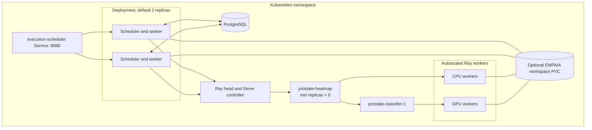

Initial settings:

| Setting | Default |
| --- | ---: |
| Lease duration | 60 seconds |
| Renewal cadence | 20 seconds |
| Worker poll interval | 0.5 seconds |
| Initial retry backoff | 5 seconds |
| Maximum retry backoff | 300 seconds |
| Processing attempts | 3 |
| Provider-finish attempts | 3 |
| Default deadline | 6 hours |
| Maximum deadline | 24 hours |
| Active processing limit | 1 per workflow |

Other deployment changes:

- Ray moved from 2.53 to 2.58 to support explicit queue rejection behavior.
- The heatmap application scales from zero to four replicas.
- Ray returns the configured `429` after its queue limit.
- `/readyz` checks durable storage availability. `/healthz/workflows` separately
  checks that declared workflows have Ray Serve routes.
- The execution scheduler stays disabled until deployment supplies its image
  tag, PostgreSQL secret, and encryption secret.
- EMPAIA mounts and gateway configuration are conditional.

Code: [`helm/rayservice/values.yaml`](../../helm/rayservice/values.yaml) and
[`helm/rayservice/templates/execution-scheduler-deployment.yaml`](../../helm/rayservice/templates/execution-scheduler-deployment.yaml).

## Commit history

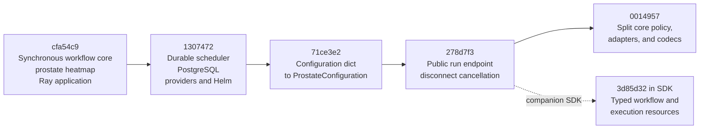

```text
model-service
  63 files
  +8,390 / -124 lines
  5 commits

rationai-sdk-python
  17 files
  +1,156 / -5 lines
  1 commit
```

## Test coverage

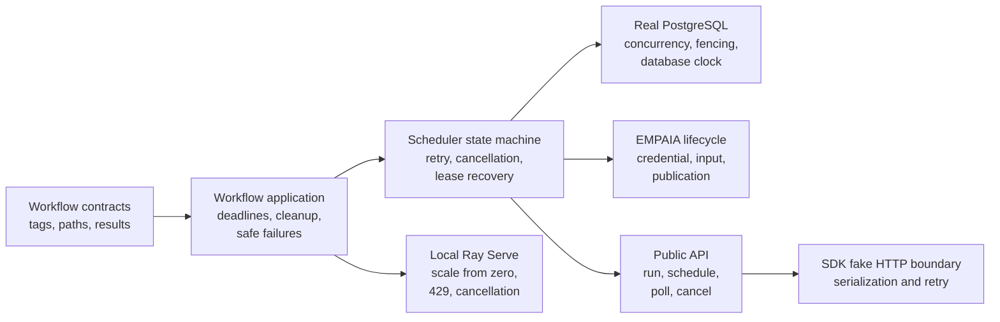

Observed verification:

```text
Model service
├── Ruff clean
├── mypy clean
├── 55 focused tests passed after the boundary cleanup
├── 9 PostgreSQL tests passed in the earlier local PostgreSQL run
└── Local Ray integration observed
    ├── scale from zero
    ├── configured 429 backpressure
    └── request cancellation after disconnect

SDK
├── Ruff clean
├── formatting clean
├── mypy clean
├── strict MkDocs build clean
├── 8 tests passed
└── 1 live integration test skipped because no service was configured
```

The cleanup added focused checks for input-access setup and cleanup failures,
outer cancellation versus workflow deadline expiry, and repository failure
translation at the scheduler boundary.

Representative test files:

- [`tests/test_workflow_application.py`](../../tests/test_workflow_application.py)
- [`tests/test_execution_scheduler.py`](../../tests/test_execution_scheduler.py)
- [`tests/test_postgres_execution_repository.py`](../../tests/test_postgres_execution_repository.py)
- [`tests/test_execution_api.py`](../../tests/test_execution_api.py)
- [`tests/test_empaia_execution.py`](../../tests/test_empaia_execution.py)

## Remaining target-cluster validation

```text
Implemented and locally validated
├── workflow contract
├── synchronous execution
├── durable scheduling
├── PostgreSQL concurrency and fencing
├── cancellation and deadlines
├── provider lifecycle
├── local Ray scale from zero
├── local Ray backpressure
└── typed SDK

Requires target-cluster release validation
├── real GPU starvation and later recovery
├── Ray cluster loss
├── Serve-controller loss
├── controller loss while scaled to zero
└── scheduler death during real in-flight cluster dispatch
```

The Kubernetes scenarios require deployed images and deliberate disruption of
remote infrastructure. Local Ray behavior does not prove those cluster-level
failure modes. The release checklist remains in
[`durable-workflow-execution.md`](durable-workflow-execution.md).
