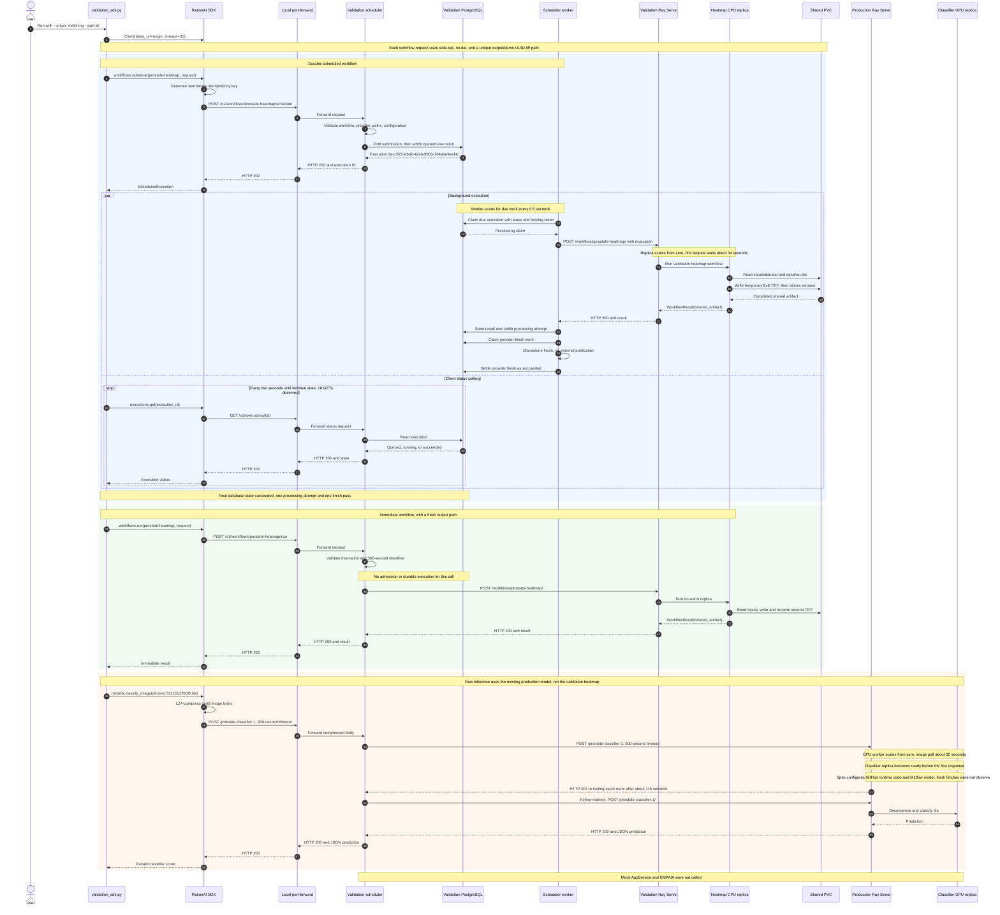

# Validation SDK demo post-mortem, 2026-09-25

Historical dummy-workflow and split-inference evidence. This did not validate
the native full-WSI implementation or real EMPAIA. Start at
[the documentation map](../README.md) for later evidence and profile selection;
do not reuse this demo unchanged against the native preset.

The run completed all three public API paths: a durable scheduled workflow, an
immediate workflow, and raw classifier inference. This was a successful
validation run, not a production workload. The observed HTTP sequence and the
`output/demo-*.tiff` paths match [`demos/validation_sdk.py`](../../demos/validation_sdk.py)
with `--part all`. The exact local command, process exit code, printed classifier
score, and immediate response body were not captured from the presenter's
terminal. Conclusions below distinguish server observations from code behavior.

All times below are on 2026-09-25 in CEST, UTC+02:00. Ray's in-container logs
display the same events in a UTC-07:00 local clock. The timeline uses the
Kubernetes access-log clock and converts database timestamps from UTC.

## What the script called

The script constructed a RationAI SDK `Client` with the supplied `--origin`.
The observed requests reached the validation execution scheduler through a
local port-forward. The scheduler's service is
`model-service-validation-execution-scheduler.peknik-ns.svc.cluster.local:8080`.
The SDK's default origin points to another namespace, so passing `--origin`
was necessary.

Each workflow request named `input/slide.dat` and `input/roi.dat` under the
shared-storage root `/mnt/validation`. It supplied a distinct
`output/demo-<uuid>.tiff` path, stride fraction `0.5`, and 256 by 256 output
tile dimensions. The files were on the `model-service-validation-shared` PVC.
The workflow was `prostate-heatmap` in both cases.

| Script call | Public HTTP call to scheduler | Scheduler's downstream work |
| --- | --- | --- |
| `client.workflows.schedule(...)` | `POST /v1/workflows/prostate-heatmap/schedule` | Validate a standalone request, insert a durable PostgreSQL execution, then have the worker dispatch it to the validation Ray Serve workflow. |
| `client.executions.get(id)` every two seconds | `GET /v1/executions/{id}` | Read the stored execution state and result. |
| `client.workflows.run(...)` | `POST /v1/workflows/prostate-heatmap/run` | Validate and dispatch directly to the same validation Ray Serve workflow. No durable execution is created. |
| `client.models.classify_image(...)` | `POST /prostate-classifier-1` | Forward the LZ4-compressed tile to the separate production Ray Serve classifier origin and return its JSON response. |

### Request sequence

The worker and polling branches overlap. The diagram groups their activity
without implying that each of the 18 status requests happened at a particular
point in the worker's processing.

The deployed scheduler used
`model-service-validation-serve-svc.peknik-ns.svc.cluster.local:8000` for
workflow dispatch and
`peknik-model-service-model-service-serve-svc.peknik-ns.svc.cluster.local:8000`
for inference. Its observed configuration set the worker poll interval to 0.5
seconds, the default scheduled deadline to 600 seconds, and the inference
timeout to 900 seconds. The scheduler image was
`cerit.io/stefanpeknik/model-service-scheduler:split-inference-redirect-20260925-1`.

## Observed timeline

| Time CEST | Observation | Result |
| --- | --- | --- |
| 10:36:10.761 | Scheduler accepted `POST /v1/workflows/prostate-heatmap/schedule`. | HTTP 202; execution `2eccff27-d9d2-42ab-9803-784abe9eefdc`. |
| 10:36:10.810 to 10:36:45.544 | Script polled that execution 18 times, roughly every two seconds. | Every status request returned HTTP 200. The last script poll followed the terminal database update. |
| 10:36:42.840 | Validation CPU worker reported its Ray runtime started. | Its replica finished initializing at 10:36:44.276. |
| 10:36:44.885 | Validation Ray Serve proxy completed the scheduled `POST /workflows/prostate-heatmap/`. | HTTP 200 after 34.047 seconds at the proxy; replica processing took 327 ms. |
| 10:36:44.975 | PostgreSQL last updated the scheduled execution. | Final state `succeeded`, one processing attempt, zero rejections, one provider-finish pass. |
| 10:36:45.597 | Validation Ray Serve proxy completed the immediate workflow request; the scheduler returned `POST /v1/workflows/prostate-heatmap/run` 200. | Warm-replica proxy time 36.4 ms; no second PostgreSQL execution. |
| 10:38:09.802 | Production GPU worker reported its Ray runtime started. | The classifier replica initialized before the response. |
| 10:38:40.511 | Production Ray Serve returned the classifier route's trailing-slash redirect. | HTTP 307 after 114.887 seconds waiting on the cold route. |
| 10:38:40.612 to 10:38:40.614 | The scheduler followed that redirect inside the cluster, received `POST /prostate-classifier-1/` 200, and returned `POST /prostate-classifier-1` 200 to the SDK. | The final Serve request took 98 ms. The server logs do not contain the numeric prediction. |

The scheduled execution began at 10:36:10.756 and reached its final database
state about 34.2 seconds later. The inference request took about 115 seconds
at the production Serve proxy, primarily while its zero-replica GPU route
started. These are cold-start observations, not processing-time benchmarks.

## What ran behind each request

For the scheduled path, the SDK generated an idempotency key and sent the
workflow body with provider `standalone`. The scheduler's
[`ExecutionScheduler`](../../execution_scheduler/scheduler.py) validated the
workflow and provider, prepared shared-storage access, and admitted a row in
`model_service.executions` through
[`PostgresExecutionRepository`](../../execution_scheduler/postgres.py). A
background [`ExecutionWorker`](../../execution_scheduler/worker.py) claimed it
under a lease and dispatched the invocation over HTTP to the validation
RayService. The scheduler, not Ray, owned the durable state and polling API.
The database row's deadline was 10:46:10.737 CEST.

Both workflow calls reached the validation
[`ValidationProstateHeatmapApplication`](../../validation/serve.py). Its
[`ProstateHeatmapWorkflow`](../../workflow_execution/prostate_heatmap.py)
resolved the two input paths and an output path on the shared volume. The
validation processor read the input bytes and wrote an 8 by 8 grayscale TIFF
to a temporary path. The workflow atomically moved the completed TIFF to its
final path and returned a `shared_artifact` result. This processor does not
perform model inference or create a clinical heatmap.

The scheduled result pointed to
`/mnt/validation/output/demo-231116c67b1a4a55a989c3b1eb165814.tiff`.
The public status API returned `succeeded` with that path and no error. A
read-only file check found the TIFF on the validation worker's shared volume
at 186 bytes. The standalone provider's finish method has no external
publication step; its one provider-finish pass advanced the durable execution
to `succeeded`.

The immediate call used a fresh workflow request and a 300-second workflow
deadline, with a 330-second client timeout. It bypassed admission, leases,
provider finish, and status polling. The second TIFF,
`/mnt/validation/output/demo-0e416e0f15114edfaee259ba2ebf4094.tiff`,
was created at the immediate Serve request time and was also 186 bytes. The
HTTP 200 and file timing support that association; the presenter's printed
`Immediate result` was not available for a direct body comparison.
The script did not compare the two workflow results; their output paths were
intentionally unique.

For inference, the script built one all-zero 512 by 512 RGB `uint8` tile. The
SDK compressed its bytes with LZ4 and posted them to the same public scheduler
origin, with a 900-second client timeout. The
[`HttpInferenceProxy`](../../execution_scheduler/inference.py) sent the body to
the existing production RayService with its own 900-second timeout. It followed
the production Serve proxy's internal 307 redirect to the trailing-slash
route, then passed the 200 response back to the SDK. The production GPU worker
used `cerit.io/rationai/model-service:2.54.0-gpu`; its image pull took about
30 seconds. The production RayService specification configures the classifier
from a GitHub `main.zip` runtime environment and an MLflow artifact through
`providers.model_provider:mlflow`, then runs ONNX inference. The captured
logs prove the route and replica served the request, but do not prove whether
this worker fetched a fresh archive or artifact rather than using a cache.

The mock AppService and EMPAIA gateway were not in this call chain. The
AppService logs showed only readiness/OpenAPI probes during the observed run.

## Outcome and limits

The scheduled workflow reached `succeeded` with one processing attempt. The
immediate workflow and raw inference requests each returned HTTP 200. The
scheduled and immediate TIFFs existed on the validation shared volume. No
error or retry appeared on the traced request paths. No external service was
mutated during this investigation; the trace used read-only logs, resource
inspection, one public status GET, file metadata checks, and one scoped
PostgreSQL `SELECT`. A temporary investigator port-forward on local port 18081
was closed afterward.

This run did not test a real EMPAIA installation, clinical model quality,
failure recovery, or GPU starvation followed by recovery. The exact
classifier score and the script's exit code require the presenter's stdout.
The production classifier's mutable GitHub `main.zip` source and MLflow
artifact configuration also mean that the container image tag alone does not
fully identify the code and model bytes used for this run.
